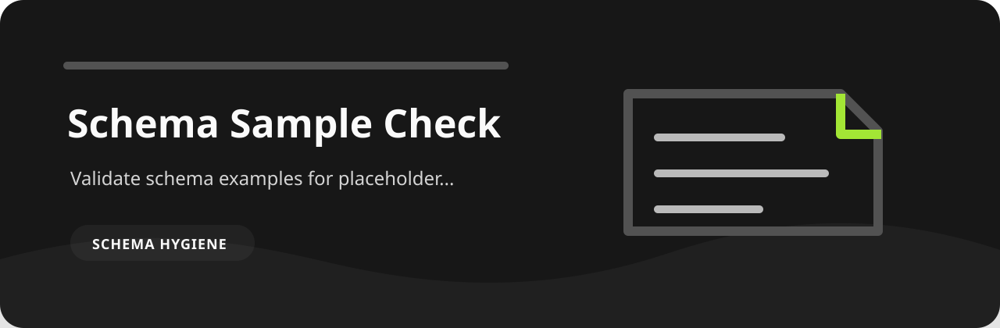

# Schema Sample Check



Validate schema examples for placeholder data and missing required samples.

`Python`

## Start here

```bash
git clone https://github.com/mertefekurt/schema-sample-check.git
cd schema-sample-check
python -m pip install -e ".[dev]"
schema-sample-check examples/sample.txt
```

## Repository

[Open the source on GitHub →](https://github.com/mertefekurt/schema-sample-check)

[MIT License](LICENSE)
